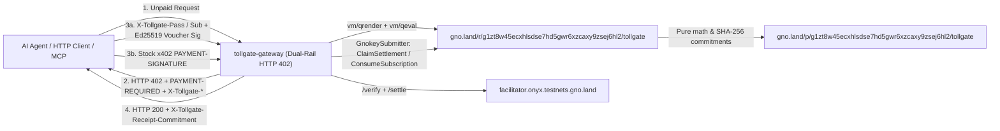

# Tollgate — On-Chain `x402` Metering, Ed25519 Prepaid Credit Vault & Receipt Protocol for Gno.land

> Built for the **Gno.land Gnome Tavern Hackathon (Nov–Dec 2026)** on Gno `v1.8.0-rc.1` (`onyx-1`).

**Tollgate** extends [`gnolang/x402`](https://github.com/gnolang/x402) from stateless per-request HTTP 402 bank transfers into a **stateful, realm-backed metering, subscription, and cryptographic receipt protocol** on Gno.land.

---

## Why Tollgate?

The official `gnolang/x402` README notes three trade-offs of stateless per-request HTTP 402 bank transfers:

1. **No realm / contract state:** *"no realm and no contract call are involved."*
2. **Sequence-race exposure:** *"A payer can consume the signed-over sequence between `/verify` and `/settle`. Settlement then fails after the seller's handler has run, so the seller does the work unpaid."*
3. **Per-call L1 latency & gas:** Every individual API call waits for an on-chain block confirmation and pays a separate L1 gas fee, and unused signed transactions never expire on their own.

**Tollgate complements direct `x402` with three interoperable rails:**

| Rail | On-Chain Settlement Cadence | Buyer Auth | Sequence-Race Exposure | Best For |
|---|---|---|---|---|
| **1. Subscription Quota** (`X-Tollgate-Sub`) | Upfront payment + batched `ConsumeSubscription` receipts | On-chain Ed25519 voucher (`crypto/ed25519.Verify`) | Escrowed upfront | Predictable high-volume API & agent workloads |
| **2. Prepaid Credit Pass** (`X-Tollgate-Pass`) | Single vault deposit + batched `ClaimSettlement` with challenge window | On-chain Ed25519 voucher (`crypto/ed25519.Verify`) | Funds locked in realm escrow | Pay-as-you-go metering with 5%–20% volume tiers & buyer dispute window |
| **3. Direct `gnolang/x402` v2** (`PAYMENT-SIGNATURE`) | Per-request via facilitator `/verify` & `/settle` | Signed Gno bank-send tx | Standard `x402` facilitator semantics | Zero-onboarding, one-shot stock `x402` callers |

---

## Trust Model & Settlement Guarantees

- **Buyer-Signed Ed25519 Vouchers:** When opening a pass (`OpenPass`) or subscription (`Subscribe`), the buyer binds a 32-byte Ed25519 `voucherPubKeyHex`. Every metered HTTP request carries `X-Tollgate-Voucher-Sig`, signing the length-prefixed domain-separated message `tollgate-voucher-v1|<chainId>|<serviceId>|<passId>|<subId>|<units>|<nonce>|<resourceHash>`. Both the off-chain gateway and the on-chain realm (`ClaimSettlement`, `ConsumeSubscription`) verify this signature via Gno `v1.8.0-rc.1`'s native `crypto/ed25519.Verify`. Neither a random third party nor a rogue provider can drain a buyer's pass or quota without a valid buyer signature.
- **Challenge Window & Non-Freezing Disputes:** Every `ClaimSettlement` locks funds into `pendingUgnot` for `svc.challengeBlocks`. During the window, the buyer may call `DisputeSettlement`. The provider may concede via `RefundDisputedSettlement`, or if the provider does not resolve the dispute within an additional `svc.challengeBlocks`, the buyer can call `ReclaimDisputedSettlement` so disputed claims can never permanently freeze a pass. Refunded receipts are marked `refunded` and return `false` from `VerifyReceiptByCommitment`.
- **Bounded Claims & Safe Defaults:** `ClaimSettlement` rejects claims after `p.expiryHeight` (protecting `ClosePass`), caps single-tx `units` (`<= 1,000,000`) and `amountUgnot` (`<= 1e15`) with overflow-checked arithmetic, and defaults `maxPerCallUgnot <= 0` to `svc.unitPriceUgnot` rather than the entire deposit.
- **Honest Revenue Accounting:** Escrowed realm settlements (`escrowedRevenue`) are tracked separately from external provider-attested `RecordX402Receipt` anchors (`x402AttestedRevenue`).
- **Gateway Persistence:** `tollgate-gateway` persists used nonces and unsettled receipts atomically to `--state-file` (single-writer model) and flushes signed vouchers on-chain via `GnokeySubmitter` (`--auto-settle` or `POST /api/settle-now`).

---

## Architecture



---

## Components

| Component | Path | Highlights |
|---|---|---|
| **Pure Gno Package** | [`gno/p/g1zt8w45ecxhlsdse7hd5gwr6xzcaxy9zsej6hl2/tollgate`](gno/p/g1zt8w45ecxhlsdse7hd5gwr6xzcaxy9zsej6hl2/tollgate/tollgate.gno) | Overflow-checked tiered volume discounts (5%–20%), x402 `extra.memo` codec (`tollgate:v1:<svc>:<nonce>`), length-prefixed SHA-256 `ReceiptCommitment`, constant-time verification |
| **Stateful Gno Realm** | [`gno/r/g1zt8w45ecxhlsdse7hd5gwr6xzcaxy9zsej6hl2/tollgate`](gno/r/g1zt8w45ecxhlsdse7hd5gwr6xzcaxy9zsej6hl2/tollgate/tollgate.gno) | Service registry, Ed25519-authenticated passes (`OpenPass`, `TopUpPass`, `RequestEarlyClose`, `ClosePass`), subscriptions (`Subscribe`, `ConsumeSubscription`), challenge-window settlements (`ClaimSettlement`, `DisputeSettlement`, `RefundDisputedSettlement`, `ReclaimDisputedSettlement`, `FinalizeSettlement`), `x402` anchoring (`RecordX402Receipt`), `GetSessionInfo()` telemetry, full `gnoweb` explorer with `$help&func=` actions & JSON views |
| **Go SDK, Middleware & Settler** | [`sdk/go/`](sdk/go/) | Canonical SHA-256 & Ed25519 voucher signing/verification, Gno ABCI `vm/qrender`/`vm/qeval` client, stock `x402 v2` facilitator bridge, atomic dual-rail `net/http` middleware with JSON persistence, and `GnokeySubmitter` batch settler |
| **Gateway & Agent / MCP CLI** | [`cmd/tollgate-gateway/`](cmd/tollgate-gateway/main.go), [`cmd/tollgate-agent/`](cmd/tollgate-agent/main.go) | Metered API (`/api/v1/oracle`, `/api/v1/weather`, `/api/v1/inference`), `keygen` + `sign-voucher` + autonomous 402-negotiating Ed25519 CLI, on-chain verifier, and MCP JSON-RPC 2.0 stdio server (`tollgate_paid_fetch`, `tollgate_chain_summary`) |
| **TypeScript SDK** | [`sdk/ts/`](sdk/ts/src/index.ts) | Zero-dependency Node ESM TypeScript client with byte-identical SHA-256 commitments and native `node:crypto` Ed25519 voucher signing/verification |
| **Web Explorer & Playground** | [`web/`](web/index.html) | Live `onyx-1` RPC explorer, HTTP 402 header inspector, and client-side WebCrypto SHA-256 receipt verifier (`https://mevlanayalcin.github.io/tollgate/`) |

---

## Security Engineering (Gno `v1.8.0-rc.1`)

- **Strict Capability Guards:** Every mutating crossing function verifies `cur.IsCurrent()`.
- **Direct EOA Payment Guard:** `OpenPass`, `TopUpPass`, and `Subscribe` require `cur.Previous().IsUserCall()` before reading `unsafe.OriginSend()`.
- **No Persisted Bankers / Realms:** `banker.NewBanker(banker.BankerTypeRealmSend, cur)` is instantiated fresh per transfer and never stored in globals.
- **O(1) Single-Denom Balance Reads:** Uses `banker.NewReadonlyBanker().GetCoin(addr, "ugnot")` rather than `GetCoins()`.
- **Zero Exported State / Pointers:** All `avl.Tree` stores are unexported; getters return value copies only.
- **Bounded Iteration & Sanitized Markdown:** `Render(path)` uses `ReverseIterateByOffset`, `markdown/sanitize/v0`, and full `/r/<addr>/tollgate:...` `gnoweb` links with Markdown-safe JSON unicode escaping.
- **Cross-Language Canonical Receipt Vector:** Identical SHA-256 output across Gno `/p/`, Go SDK, TypeScript SDK, and WebCrypto (`cfdf0dc69056f30d26543f18accf341c2f44d65fcd86a72a21f845c66010eafc`).

---

## Quick Start & Verification

```bash
# 1. Run Gno unit tests & linter (v1.8.0-rc.1)
make gno-test && make gno-lint

# 2. Build binaries and run Go race tests + TypeScript SDK tests
make build && make go-test && make ts-test

# 3. Run full end-to-end test on live local gnodev v1.8.0-rc.1
#    (deploys /p/ & /r/, generates Ed25519 voucher keypair, opens pass & sub,
#     verifies 401 on unsigned request, 200 on signed pass & sub, 409 on replay,
#     tests MCP stdio, flushes real on-chain settlement via GnokeySubmitter,
#     verifies receipts on-chain & checks live gnoweb rendering)
make e2e
```

---

## Live `onyx-1` Deployment & Links

- **Pure Package:** `gno.land/p/g1zt8w45ecxhlsdse7hd5gwr6xzcaxy9zsej6hl2/tollgate`
- **Stateful Realm:** `gno.land/r/g1zt8w45ecxhlsdse7hd5gwr6xzcaxy9zsej6hl2/tollgate`
- **gnoweb Explorer:** `https://onyx.testnets.gno.land/r/g1zt8w45ecxhlsdse7hd5gwr6xzcaxy9zsej6hl2/tollgate`
- **Interactive Web Explorer:** `https://mevlanayalcin.github.io/tollgate/`
- **x402 Facilitator:** `https://facilitator.onyx.testnets.gno.land` (`gno:onyx-1`)
