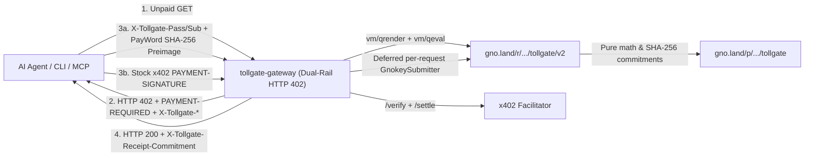

# Tollgate — On-Chain `x402` Metering, PayWord SHA-256 Credit Vault & Receipt Protocol for Gno.land

> Built for the **Gno.land Gnome Tavern Hackathon (Nov–Dec 2026)** using the Gno `v1.8.0-rc.1` toolchain (`onyx-1`).

**Tollgate** extends [`gnolang/x402`](https://github.com/gnolang/x402) from stateless per-request HTTP 402 bank transfers into a **stateful, realm-backed metering, subscription, and cryptographic receipt protocol** on Gno.land.

---

## Why Tollgate?

The official `gnolang/x402` README notes three trade-offs of stateless per-request HTTP 402 bank transfers:

1. **No realm / contract state:** *"no realm and no contract call are involved."*
2. **Sequence-race exposure:** *"A payer can consume the signed-over sequence between `/verify` and `/settle`. Settlement then fails after the seller's handler has run, so the seller does the work unpaid."*
3. **Per-call L1 latency & gas:** Every individual API call waits for an on-chain block confirmation and pays a separate L1 gas fee, and unused signed transactions never expire on their own.

**Tollgate complements direct `x402` with three interoperable rails:**

| Rail | On-Chain Settlement Cadence | Buyer Auth | Settlement Model | Best For |
|---|---|---|---|---|
| **1. Subscription Quota** (`X-Tollgate-Sub`) | Upfront payment + deferred `ConsumeSubscription` receipt anchoring | On-chain PayWord SHA-256 hash-chain (`crypto/sha256`) | Paid upfront directly to `payTo` (immediate settlement) | Predictable high-volume API & agent workloads |
| **2. Prepaid Credit Pass** (`X-Tollgate-Pass`) | Single vault deposit + deferred `ClaimSettlement` with challenge window | On-chain PayWord SHA-256 hash-chain (`crypto/sha256`) | Funds locked in realm escrow | Pay-as-you-go metering with 5%–20% volume tiers & buyer dispute window |
| **3. Direct `gnolang/x402` v2** (`PAYMENT-SIGNATURE`) | Per-request via facilitator `/verify` & `/settle` | Signed Gno bank-send tx | Standard `x402` facilitator semantics (tested via mock facilitator in SDK unit tests) | Zero-onboarding, one-shot stock `x402` callers |

---

## Architecture



---

## Trust Model, Settlement Guarantees & Known Trade-Offs

- **Rivest-Shamir PayWord SHA-256 Hash-Chain Vouchers (GPAS-Native):** When opening a pass (`OpenPass`) or subscription (`Subscribe`), the buyer derives a domain-separated SHA-256 hash chain `w_i = SHA256("tollgate-payword-v1|" + chainID + "|" + w_{i-1})` (`i = 1..N`) and anchors `w_N` on-chain (`voucherPubKey`). To authorize `u` units (`1 <= u <= 1024`), the buyer reveals `w_{pos - u}` in `X-Tollgate-Voucher-Sig`. Both the off-chain gateway and the on-chain realm (`ClaimSettlement`, `ConsumeSubscription`) verify `SHA256^u(preimage) == currentAnchor` (up to 1,024 SHA-256 hashes per claim) and advance the anchor to `preimage`.
  - **Cryptographic overcharge resistance:** A provider holding `w_{pos - u}` cannot claim `u + 1` units without inverting SHA-256.
  - **Deferred per-request settlement:** The gateway serializes requests per pass/sub (`lockPass`/`lockSub`), persists local anchors in `--state-file` (and stateful `tollgate-agent --state-file` tracks client anchors across back-to-back calls before flush), and submits one on-chain tx per served HTTP request in strict chain order. Transient RPC errors pause that pass's flush for retry without dead-lettering; post-broadcast crash recovery looks up receipts by commitment on chain.
  - **Known PayWord trade-offs:** Because intermediate hash-chain preimages are derivable by the provider, a provider could split a multi-unit proof into smaller claims to avoid the 5%–20% volume discount (mitigated by per-call `maxPerCallUgnot` caps, dispute window visibility, or upfront subscriptions). Receipts served in the final few blocks before `p.expiryHeight` should be flushed promptly before pass expiry rejects new claims. Use a distinct PayWord seed per pass/subscription.
  - **Immutable `gnoweb` UI label note:** Deployed `render.gno` headers on `tollgate/v2` retain legacy `"Ed25519 Signed"` / `"Ed25519 Voucher Key"` labels from v1, while active on-chain verification in `tollgate/v2` uses pure `crypto/sha256` PayWord hash-chain preimages (`payword:<hash>`).
- **Challenge Window & Non-Freezing Disputes:** Every `ClaimSettlement` locks funds into `pendingUgnot` for `svc.challengeBlocks`. During the window, the buyer may call `DisputeSettlement`. The provider may concede via `RefundDisputedSettlement`, or if unresolved after an additional `svc.challengeBlocks`, the buyer may call `ReclaimDisputedSettlement` so disputed claims never permanently freeze a pass. _Optimistic-dispute trade-off:_ a buyer can unilaterally dispute and reclaim without cryptographic proof of non-delivery; providers mitigate this via short challenge windows, reputation, or the upfront-settled subscription rail. Refunded receipts return `false` from `VerifyReceiptByCommitment`.
- **Honest Revenue Accounting:** On-chain realm revenue (settled pass claims + upfront subscription payments) is tracked separately from external provider-attested `RecordX402Receipt` anchors (`x402AttestedRevenue`).
- **Gateway Admin Controls:** `/api/settle-now` and `/api/explorer/pending-receipts` are restricted to loopback callers or `--admin-token`, without wildcard CORS, and redact `buyerSigHex`.

---

## Quick Start & Usage

```bash
# 1. Run Gno unit tests & linter (override GNOROOT / GNO_BIN for your local Gno v1.8.0-rc.1 checkout)
make gno-test && make gno-lint

# 2. Build binaries and run Go race tests (10 tests incl. concurrency, crash recovery, 5xx rollback) & TS SDK tests (6 tests)
make build && make go-test && make ts-test

# 3. Verify a live onyx-1 on-chain receipt from the CLI (zero keys required)
./bin/tollgate-agent verify \
  --rpc https://rpc.onyx.testnets.gno.land:443 \
  --realm gno.land/r/g1zt8w45ecxhlsdse7hd5gwr6xzcaxy9zsej6hl2/tollgate/v2 \
  --receipt 1

# 4. Run full local gnodev v1.8.0-rc.1 E2E (requires local gnodev/gnokey binaries & deployer key paths)
make e2e
```

---

## Live `onyx-1` Deployment & Disclosures

- **Pure Package:** `gno.land/p/g1zt8w45ecxhlsdse7hd5gwr6xzcaxy9zsej6hl2/tollgate` (GPAS `passed`, Height `1418662`, TX `y7PvM1RcN0w+a93EUvpqzep2H5GrkczQRCpncVX0FQU=`)
- **Stateful Realm:** `gno.land/r/g1zt8w45ecxhlsdse7hd5gwr6xzcaxy9zsej6hl2/tollgate/v2` (GPAS `passed`, Height `1421205`, TX `VWXGKOXB6hlxXKhofmbpnlKyamaCRPpbtAIPNf/SIs0=`)
- **gnoweb Explorer:** https://onyx.testnets.gno.land/r/g1zt8w45ecxhlsdse7hd5gwr6xzcaxy9zsej6hl2/tollgate/v2
- **GPAS Verification (`passed`):** https://gpas.onyx.testnets.gno.land/?path=gno.land/r/g1zt8w45ecxhlsdse7hd5gwr6xzcaxy9zsej6hl2/tollgate/v2
- **Static Web Explorer (GitHub Pages):** https://mevlanayalcin.github.io/tollgate/ _(syncs live `onyx-1` RPC & verifies receipts via WebCrypto; live HTTP 402 playground probes require running `tollgate-gateway` locally)_
- **HD Demo Video (1080p MP4, 2m15s):** [Watch / Download `tollgate-demo-1080p.mp4`](https://github.com/mevlanayalcin/tollgate/releases/download/v1.0.0/tollgate-demo-1080p.mp4)
- **Live On-Chain Seed Proofs (`onyx-1`):** `RegisterService` (`nP5+Osiv...`, `1422294`), `OpenPass` (`qU0c1+sl...`, `1422296`), `Subscribe` (`Wel/RCva...`, `1422298`), `ClaimSettlement` (`swm9I/8A...`, `1422300`), `ConsumeSubscription` (`9uPRWiOu...`, `1422302`), `RecordX402Receipt` (`71xFO4lD...`, `1422304`), `FinalizeSettlement` (`XP9CjvtV...`, `1422323`, `9,500 ugnot` paid).
  - _Disclosure:_ These seed transactions were broadcast directly via `gnokey` (`scripts/deploy_onyx.sh`) with the deployer address acting as buyer, provider, and `payTo`. Receipt `#3` (`x402-onyx-facilitator-demo-001`) is a synthetic `RecordX402Receipt` anchor demonstrating the anchoring schema (no external x402 facilitator bank transfer occurred; the x402 HTTP rail is verified via mock facilitator in `sdk/go/middleware_test.go`).
- **Self-Published Static Analysis Certificate (Author's Companion Analyzer `r/.../ironclad` #6 — Grade A+ 100/100):** https://onyx.testnets.gno.land/r/g1zt8w45ecxhlsdse7hd5gwr6xzcaxy9zsej6hl2/ironclad:attestation/6 _(independently reproducible via `ironclad scan --remote https://rpc.onyx.testnets.gno.land:443 gno.land/r/g1zt8w45ecxhlsdse7hd5gwr6xzcaxy9zsej6hl2/tollgate/v2`)_
